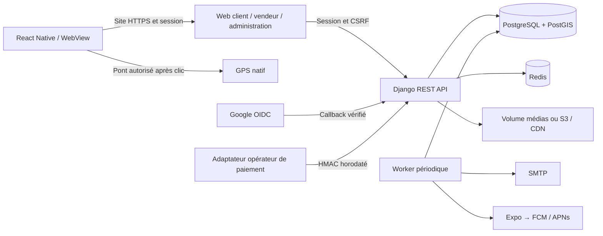

# Architecture, données et règles du code

## Structure et flux



Le serveur est un monolithe modulaire. Un MVP ne gagne pas à multiplier des services indépendants avant d’en connaître les besoins d’exploitation. L’API concentre identité, permissions, publication et droits ; l’interface ne décide jamais du prix ou de l’activation d’une formule. La séparation en microservices est une évolution possible, pas un prérequis au fonctionnement.

Sites héberge des applications Worker avec des connexions HTTP, alors que cette architecture utilise PostgreSQL/PostGIS et Django WSGI. La livraison cible donc l’infrastructure Docker documentée, dans le workspace fourni, et n’est pas publiée comme une page statique qui prétendrait fournir les mêmes services persistants. Aucune URL publique de production n’a été créée.

## Tables et responsabilités

| Entité | Rôle | Invariant essentiel |
| --- | --- | --- |
| User | Identité, contacts, rôle métier, permissions Django | Hash de mot de passe ; username/email uniques sans casse |
| SocialIdentity | Liaison Google vérifiée | Un sub Google appartient à un seul compte |
| Vendor | Commerce, coordonnées publiques, validation, statut | Un propriétaire ; coordonnées bornées ; publication contrôlée |
| Category | Hiérarchie des offres | Aucun cycle ; catégorie utilisée non supprimable |
| Product | Prix FCFA, disponibilité et photo | Propriété par commerce ; prix positif ; média réencodé |
| OpeningHour | Plage locale hebdomadaire | Lundi=0 ; heures distinctes ; nuit acceptée |
| OpeningException | Remplacement d’une date | Une date par commerce ; plage ouverte dans une seule journée |
| Review | Avis et réponse | Un avis par client/commerce ; note 1–5 en SQL |
| Report | Dossier de contenu signalé | Exactement un avis ou un commerce comme cible |
| Favorite | Commerce préféré | Paire compte/commerce unique |
| Notification | Message durable | Clé de dédoublonnage optionnelle unique |
| AlertZone | Centre privé consenti | Une zone par client, supprimable immédiatement |
| Promotion | Campagne commerçante | Droits et quota vérifiés sous verrou du commerce |
| Subscription | Historique des droits | Une période connue, début/fin et montant réellement payé |
| Payment | Demande et reçu vérifié | Référence locale unique ; reçu payé non réutilisable ; une activation |
| Audit | Actions sensibles | Lecture protégée ; pas d’édition financière arbitraire |
| SearchEvent | Tendances anonymes | Mot-clé et commerces présentés, pas de coordonnées clientes |
| Configuration | Paramètres publics autorisés | Liste blanche exposée ; types/rayons validés en back-office |
| Device | Token push consenti | Token unique ; propriétaire vérifié à chaque envoi |
| PushDelivery | État d’acheminement | Une tâche par message et terminal ; reprises bornées |

Les suppressions et cascades sont décrites par les `ForeignKey`. Une fermeture de compte est une désactivation, pas une suppression SQL : elle masque le commerce et retire immédiatement terminaux et zone privée. Un effacement définitif requiert un opérateur qui applique la politique réelle de conservation. Les obligations légales ne sont pas inventées dans le code.

## Recherche géographique

1. Le serveur valide latitude, longitude, finitude des nombres et rayon 100–20 000 m.
2. Il sélectionne seulement les commerces approuvés de comptes actifs.
3. Sur PostgreSQL, `ST_DWithin` utilise une géographie WGS84 indexée par GiST. Le préfiltre surinclut de 1 % pour absorber la différence sphéroïde/sphère avec le calcul final.
4. Sur SQLite, un rectangle en latitude réduit les candidats. La longitude n’est pas filtrée de façon naïve : cela casserait les recherches traversant l’antiméridien.
5. Haversine calcule la distance finale en mètres, puis la borne du rayon est vérifiée strictement.
6. Mot-clé et catégorie portent sur les produits **publiables et disponibles**, pas sur ceux conservés au-delà du quota.
7. L’ouverture est évaluée depuis les horaires et exceptions au moment de la requête.
8. Le classement applique la formule active, la proximité et un dernier critère stable.
9. Les résultats sont paginés par trente. La fiche conserve les cinquante avis visibles les plus récents.

Les relations nécessaires sont préchargées pour éviter une requête par commerce, plage, note et produit. Redis peut mémoriser trente secondes la présélection géographique sous une empreinte du point/rayon ; les états de publication, suspensions, offres et droits restent réévalués. Un nouveau commerce ou un déplacement peut donc mettre au plus trente secondes à apparaître dans une présélection déjà en cache. Le cache ne crée jamais un droit commercial.

À grande échelle, le classement de tous les candidats et le ciblage des zones sont encore des traitements Python. Le passage à une présélection/ranking entièrement SQL, à des agrégats de recherche et à un worker de campagne par lots doit être décidé à partir d’un test de charge représentatif.

## Authentification et permissions

Le navigateur et la coque mobile utilisent une session Django en cookie HttpOnly. Les mutations passent par le CSRF ; la connexion et l’inscription anonymes sont également protégées. Les cookies Secure et la redirection HTTPS s’activent en production. Le frontend utilise une CSP qui interdit les scripts inline et les sources arbitraires de JavaScript.

Les clients API disposent de jetons JWT : accès quinze minutes, refresh sept jours, rotation, blacklist après rotation et refus de comptes suspendus. Le changement de mot de passe invalide l’empreinte vérifiée dans les access tokens et met les refresh tokens connus sur liste noire. Les endpoints JWT utilisent l’identifiant `username`, tandis que la connexion par session accepte aussi email et téléphone.

Les petits corps d’action sont validés par des champs DRF explicitement déclarés. Aucun champ de rôle ou de validation commerciale fourni par l’utilisateur ne remplace une décision serveur. Les opérations de vendeur résolvent systématiquement le commerce par le propriétaire connecté. Les actions administratives exigent `is_staff` **et** la permission métier correspondante. Les comptes staff ne sont pas suspendables par l’outil simplifié.

Les groupes sont initialisés par `create_roles`, mais aucune personne n’y est inscrite automatiquement. Dans le back-office, les modérateurs ordinaires ne peuvent pas modifier is_staff, is_superuser, groupes, permissions ou rôle, ni éditer un compte staff. Les superadministrateurs disposent néanmoins de pouvoirs étendus : limitez leur nombre, protégez leurs identifiants et prévoyez une authentification forte supplémentaire avant ouverture publique du back-office. Le MFA administrateur n’est pas inclus dans cette version.

Les throttles applicatifs limitent les requêtes et les connexions. En production multi-processus, Redis est nécessaire au partage des compteurs. Un contrôle au proxy/WAF, une politique de verrouillage ciblée par compte et une résistance DDoS complète constituent des défenses complémentaires non promises par un simple throttle Django.

## Google OIDC

Le parcours web commence par un POST protégé et consenti. Le serveur garde state, nonce et vérificateur PKCE dans la session ; le callback les consomme une fois et exige un retour en moins de dix minutes. Les échanges token/JWKS utilisent exclusivement les URLs officielles fixes avec timeout. La signature est RS256 et les claims obligatoires, audience, expiration, émetteur, nonce et email vérifié sont contrôlés.

Le sub est la clé d’identité. Pour un nouvel email, un compte client sans mot de passe utilisable est créé. Un email déjà connu n’est pas fusionné : l’utilisateur doit d’abord se connecter au compte existant puis lier Google. Un compte social peut définir un mot de passe par la récupération email avant les opérations qui l’exigent. Les fournisseurs sont simulés dans les tests ; l’écran de consentement réel doit être testé avec vos credentials.

## Cycle financier et concurrence

Un nouveau vendeur reçoit un trial à l’enrôlement. Les droits proviennent de la période la plus récente dont `start <= maintenant < end`. Sans période valide, la formule fonctionnelle de repli est Découverte. Les alertes d’échéance ne déterminent donc pas les droits.

Une demande enregistre formule, montant calculé, abonnement de référence et identifiant aléatoire. Le vendeur ne fournit jamais le montant. Un verrou du commerce protège le quota et les demandes concurrentes. Le reçu confirmé est unique en SQL, même si deux opérateurs essaient de le réutiliser dans deux commerces.

La confirmation verrouille la demande puis le commerce, exige une référence de reçu, vérifie l’âge du devis, les droits de référence et le sens de l’upgrade, termine la période précédente et crée la nouvelle. Paiement, abonnement, message et audit sont dans une transaction. Une répétition de la même confirmation retourne la même activation.

L’adaptateur externe doit appeler :

`POST /api/v1/payments/webhook/`

Corps exact d’exemple :

```json
{"reference":"MGB-REFERENCE_GENEREE","status":"paid","amount":1500,"currency":"XOF","external_reference":"OPERATEUR-RECU-UNIQUE"}
```

En-têtes requis :

| En-tête | Valeur |
| --- | --- |
| `Content-Type` | `application/json` |
| `X-Miagbo-Timestamp` | Unix timestamp entier de l’adaptateur |
| `X-Miagbo-Signature` | Hexadécimal du HMAC-SHA256 décrit ci-dessous |

La chaîne signée est `timestamp + b'.' + octets_exacts_du_corps`. Le secret est `PAYMENT_WEBHOOK_SECRET`. La comparaison est constante en temps, la fenêtre réseau est de cinq minutes et le corps limité à 10 000 octets. Montant, devise, état et référence externe sont contrôlés. Un secret absent donne 503 ; signature incorrecte 401 ; événement signé incohérent 400. Le webhook est exempté de CSRF car un serveur fournisseur n’a pas de session navigateur ; cette exemption ne s’étend pas aux autres routes.

La signature de notre adaptateur ne remplace pas celle de l’opérateur. L’adaptateur doit vérifier le vrai fournisseur et l’état final de la transaction avant traduction. Un HMAC partagé doit être conservé comme un secret serveur, jamais dans l’application mobile.

## Notifications et alertes

La boîte interne est durable. Les réponses, décisions, rappels et campagnes y sont stockés même sans transport distant. Les zones de proximité sont privées et opt-in ; les nouveaux commerces sont détectés sur une fenêtre de sept jours depuis leur création. Une validation après ces sept jours n’est pas détectée comme nouvelle dans cette version : ajouter un `published_at` est une évolution identifiée.

La commande `send_push` ne travaille que les notifications des vingt-quatre dernières heures. Elle crée une tâche unique par terminal, transmet le message via Expo et attend le reçu. Les erreurs transitoires sont espacées ; chaque stade est borné à cinq tentatives. Une destination réattribuée à un autre compte est refusée. Les envois sont de type « au moins une tentative contrôlée », pas une promesse d’exactement une livraison : une panne entre l’acceptation fournisseur et la sauvegarde locale peut produire une répétition. Le client et le fournisseur doivent gérer ces cas normaux de réseau.

Les tokens invalides donnant DeviceNotRegistered aboutissent à un échec de tâche. Ils doivent être supprimés ou réenregistrés par l’exploitation ; l’autonettoyage global de tokens invalides est une amélioration identifiée. Ni ticket ni reçu ne changent l’indicateur « lu » de la notification.

## Médias et fichiers de configuration

Les images sont décodées avec Pillow, redimensionnées à 1400×1400 maximum, converties en RGB et réencodées en JPEG avec un nom aléatoire. Le stockage local est indépendant du code. Avec S3, les clés restent serveur et les URLs de médias sont fournies par le stockage configuré. Les images ne sont jamais exécutées comme des scripts.

`package.json` décrit la bibliothèque de carte et Playwright ; son lockfile fige les versions. `mobile/package.json` déclare Expo, React Native, WebView, GPS, safe areas et notifications ; `tsconfig.json` impose le mode strict ; `eas.json` déclare les profils de build sans credentials. `requirements.lock.txt` fige les packages Python installés. Ces formats ne sont pas dénaturés par des commentaires non permis.

## Références techniques

Les décisions de protocole ont été vérifiées avec les sources officielles : [authentification DRF](https://www.django-rest-framework.org/api-guide/authentication/), [permissions DRF](https://www.django-rest-framework.org/api-guide/permissions/), [utilisateur Django personnalisé](https://docs.djangoproject.com/en/5.2/topics/auth/customizing/), [Google OpenID Connect](https://developers.google.com/identity/openid-connect/openid-connect), [push Expo](https://docs.expo.dev/push-notifications/sending-notifications/), [compatibilité Expo SDK 54](https://docs.expo.dev/versions/v54.0.0/). Ces références expliquent les protocoles ; la preuve du comportement livré reste la suite de recette locale.

La limite des corps de requête du proxy utilise la directive officielle [request_body de Caddy](https://caddyserver.com/docs/caddyfile/directives/request_body), avant transfert à Django. Elle complète les limites de poids et dimensions appliquées aux images.
